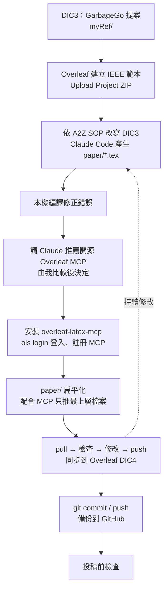

# ICEIB 2027 — GarbageGo Paper

**作業主旨：** 以 ICEIB 2027 會議論文格式（IEEE `IEEEtran` conference，4–8 頁）改寫 DIC3 的內容。DIC3 的原始資料放在 `myRef/`，改寫後的論文放在 `paper/`，並同步到 Overleaf 專案 **DIC4**。

> **When to Advise and When to Defer: A Domain-Specific Tool-Grounded Agent for Departure Decisions in Curbside Waste Collection**

本研究以臺中市為場域，提出 **GarbageGo**：一個工具約束（tool-grounded）的 Domain AI Agent，用時間餘裕
`slack = ETA − 步行時間 − 安全緩衝` 判斷居民「現在出門是否趕得上垃圾車」，並在資料過期或無效時主動降級（defer）。

> **Status:** 論文架構、方法與評估設計已完成；回測尚未執行，結果表仍為空白。

---

## 1. 作業流程



| 步驟 | 做什麼 | 說明 |
|---|---|---|
| 1. 準備素材 | 把 DIC3 提案、A2Z 寫作 SOP 放進 `myRef/` | 改寫的依據，不參與編譯 |
| 2. 建立範本 | Overleaf → New Project → Upload Project，上傳 IEEE conference 範本 ZIP | 見第 4 節 |
| 3. 改寫內容 | 請 Claude Code 依 A2Z SOP 把 DIC3 改寫成各章節 `.tex` | 見第 3 節 |
| 4. 本機編譯 | `latexmk -pdf main.tex`，修正編譯錯誤 | 見第 4 節 |
| 5. 選擇 MCP | 直接下 prompt 請 Claude 推薦開源 Overleaf MCP 並比較，由我決定採用哪一個 | 見 5.1 |
| 6. 安裝與登入 | 安裝 overleaf-latex-mcp，用 `ols login` 或 F12 複製 cookie 登入，註冊到 Claude Code | 見 5.2–5.4 |
| 7. 同步 Overleaf | pull → 靜態檢查 → 修改 → push 到 Overleaf 專案 DIC4 | 見 5.5 |
| 8. 版本備份 | `git commit` / `git push` 到 GitHub | `.olauth`、`.mcp.json` 不進版控 |
| 9. 投稿前檢查 | 頁數、參考文獻、實驗結果 | 見第 6 節 |

---

## 2. Repository 結構

```text
ICEIB2027/
├── README.md                  # 本檔案
├── .gitignore                 # 排除 LaTeX 中間檔、.olauth、.mcp.json
├── myRef/                     # 參考資料（不參與編譯）
│   ├── README.md              # GarbageGo 系統原始 README
│   ├── 內容.txt               # 中英文摘要與 Index Terms
│   ├── GarbageGo_提案規格書.pdf
│   ├── A2Z outline example.pdf / .docx   # A–Z 論文寫作 SOP
│   └── GarbageGo.webp
└── paper/                     # Overleaf 專案本體（扁平結構）
    ├── main.tex               # 主檔：組合所有章節
    ├── 00_abstract.tex
    ├── 01_introduction.tex
    ├── 02_related_work.tex
    ├── 03_proposed_scheme.tex
    ├── 04_experiments.tex
    ├── 05_conclusion.tex
    ├── table_comparison.tex   # 預測方法比較表（結果待填）
    ├── references.bib
    └── figures/               # 向量圖檔（架構圖目前以 TikZ 繪製）
```

`paper/` 採**扁平結構**（不用 `sections/`、`tables/` 子目錄），以便透過 MCP 直接推送到 Overleaf。章節分檔的好處是：不同成員或 AI agent 可各自編輯一個章節，不必動到 `main.tex`。

---

## 3. 論文結構與 A–Z 寫作框架

每個章節的段落都依 `myRef/A2Z outline example.pdf` 的 A–Z SOP 撰寫，`.tex` 中以註解標示（如 `% G. General`、`% PA. Aim`）。

| 章節 | 檔案 | A–Z 段落 | 要回答的問題 | 建議篇幅（6 頁版） |
|---|---|---|---|---|
| Abstract | `00_abstract.tex` | A–F | 問題、方法、結果與意義 | 0.3 頁 |
| I. Introduction | `01_introduction.tex` | G–L | 為什麼這個研究必要？ | 0.9 頁 |
| II. Related Work | `02_related_work.tex` | M–O | 已有哪些做法？缺什麼？（含 SWOT 表） | 0.75 頁 |
| III. Proposed Scheme | `03_proposed_scheme.tex` | PA–PM | 創新在哪？如何運作？（公式、架構圖、演算法、證明） | 1.8 頁 |
| IV. Simulation | `04_experiments.tex` | Q–V | 如何證明有效？ | 1.65 頁 |
| V. Conclusion | `05_conclusion.tex` | W–Z | 學到什麼？還有什麼未解決？ | 0.6 頁（含參考文獻） |

寫作邏輯：

- **Abstract**：完整的研究故事
- **Introduction**：背景 → 問題 → 研究缺口 → 貢獻
- **Related Work**：既有方法 → 比較 → 限制
- **Proposed Scheme**：架構 → 數學模型 → 演算法
- **Experiments**：資料集 → 基線 → 指標 → 結果 → 討論
- **Conclusion**：發現 → 意涵 → 限制 → 未來工作
- **References**：可查證的科學證據

---

## 4. 編譯

### Overleaf（建議）

1. 將 `paper/` 目錄內容壓縮成 ZIP（例如 `GarbageGo-paper.zip`，已列入 `.gitignore`）。
2. Overleaf → **New Project → Upload Project** → 上傳 ZIP（之後的同步可改用第 5 節的 Overleaf MCP）。
3. Main document 設為 `main.tex`，Compiler 選 **pdfLaTeX**。
4. 按 **Recompile**。

### 本機

```bash
cd paper
latexmk -pdf main.tex
```

需安裝 `IEEEtran` 與 `main.tex` 中列出的套件（`cite`、`amsmath`、`booktabs`、`algorithm`、`algpseudocode`、`tikz` 等）。`main.tex` 偵測到 XeTeX 時會改用 TeX Gyre Termes 字型，方便用 Tectonic 預覽；Overleaf 的 pdfLaTeX 則直接使用 Times。

---

## 5. Overleaf MCP：讓 Claude Code 直接讀寫 Overleaf 專案

本專案使用 **[overleaf-latex-mcp](https://github.com/ghostiee-11/overleaf-mcp)**（v1.0.1，MIT）把 `paper/` 和 Overleaf 專案同步：Claude Code 可以在同一輪對話中完成「pull → 檢查／修改 → push」。

### 5.1 查找：請 Claude 推薦，由我決定

MCP server 不是自己搜尋挑的，而是在 Claude Code 中**直接下 prompt**，請 Claude 推薦開源的 Overleaf MCP 並比較優缺點，**最後由我決定**採用哪一個。prompt 範例：

> 「請推薦可以讓 Claude Code 讀寫 Overleaf 專案的**開源** MCP server，比較同步方式、是否需要 Overleaf 付費方案、安裝難度與限制，並給出推薦。」

Claude 整理出的候選：

| Server | 同步方式 | 是否需要 Overleaf Premium |
|---|---|---|
| **overleaf-latex-mcp**（[ghostiee-11/overleaf-mcp](https://github.com/ghostiee-11/overleaf-mcp)，本專案採用） | 瀏覽器登入取得 session cookie（`.olauth`），透過 Overleaf REST 端點下載／上傳 | **免費帳號即可**（Premium 的 Git 模式為選用） |
| overleaf-mcp-server（PyPI） | Overleaf 每個專案的 Git remote | 需要（Git 整合是付費功能） |
| tamirsida/overleaf_mcp | Git，寫入後立即 commit + push | 需要 |
| Junfei-Z/overleaf-claude-mcp | Git，本機修改，明確呼叫 `push_changes` 才推送 | 需要 |

我的決定與理由：採用 **overleaf-latex-mcp**。Overleaf 的 Git 同步只開放給付費方案，而這個 server 能讓**免費帳號**從 AI agent 做 pull／push。它還附帶 LaTeX 靜態檢查工具（數學式、圖表、套件、label／ref 一致性等），適合論文寫作。

> 注意：mcpservers.org 這類網站只是目錄，頁面網址**不是** MCP endpoint，不能直接當成 server URL 加入任何 IDE。

### 5.2 安裝

**前置需求**

| 工具 | 用途 | 安裝（Windows） |
|---|---|---|
| Python ≥ 3.11 | 執行 MCP server | <https://www.python.org/> |
| uv | 安裝與執行 Python CLI 工具 | `powershell -ExecutionPolicy ByPass -c "irm https://astral.sh/uv/install.ps1 \| iex"` |
| Claude Code CLI | 註冊與使用 MCP server | 需已安裝並加入 PATH |
| TeX Live／MiKTeX（選用） | 提供 `latexmk`、`chktex`、`latexindent`，啟用 `compile`、`lint_file`、`format_file` | 沒裝也不影響 server 啟動 |

**安裝 server 與登入工具**

```powershell
# MCP server 本體
uv tool install overleaf-latex-mcp      # 或 pipx install overleaf-latex-mcp

# ols 登入工具（來自 overleaf-sync，只用它的瀏覽器登入功能）
uv tool install "overleaf-sync[gui]"    # [gui] 會裝 PySide6，ols login 的登入視窗需要它
```

### 5.3 登入 Overleaf（產生 `.olauth`）

在**論文資料夾**（即 `OVERLEAF_PROJECT_ROOT`）執行：

#### 方法一：登入視窗（`ols login`）

```powershell
cd D:\class\AIoTAI\ICEIB2027\paper
ols login
```

> 剛裝完 uv 的終端機（包括已開啟的 Claude Code）PATH 還沒更新，會出現 `ols: command not found`。請重新開終端機，或改用完整路徑 `C:\Users\<使用者>\.local\bin\ols.exe login`。

指令會開啟瀏覽器讓你登入 Overleaf，然後在目前目錄寫入 `.olauth`（session cookie）。server 預設讀取 `$OVERLEAF_PROJECT_ROOT/.olauth`；要放在別處的話，用 `OVERLEAF_OLS_COOKIE` 指定路徑。

成功時會顯示：

```text
Login successful. Cookie persisted as `.olauth`. You may now sync your project.
```

驗證：`ols list` 能列出你的 Overleaf 專案（本專案為 **DIC4**），就代表登入有效。

#### 方法二：F12 手動複製 session cookie（`ols login --cookie`）

適用情況：登入視窗打不開（缺 PySide6、遠端或無螢幕環境）、學校電腦不能裝 GUI 套件，或帳號透過學校 SSO 登入。

1. 用瀏覽器登入 <https://www.overleaf.com>。
2. 按 **F12** 開啟開發人員工具：
   - Chrome／Edge：**Application** 分頁 → 左側 **Storage → Cookies → `https://www.overleaf.com`**
   - Firefox：**Storage（儲存空間）** 分頁 → **Cookies → `https://www.overleaf.com`**
3. 找到名稱為 **`overleaf_session2`** 的 cookie，複製它的 **Value**（通常以 `s%3A` 開頭的一長串；只要值，不要連名稱一起複製）。自架的 Overleaf 伺服器則改用 `overleaf.sid`。
4. 在論文資料夾執行，於隱藏提示輸入時貼上剛才的值，按 Enter：

   ```powershell
   cd D:\class\AIoTAI\ICEIB2027\paper
   ols login --cookie
   ```

   也可以先把值放進環境變數 `OLSYNC_COOKIE`，就不會出現提示（用完記得清掉，避免留在 shell 歷史或環境中）：

   ```powershell
   $env:OLSYNC_COOKIE = "<貼上 overleaf_session2 的值>"
   ols login --cookie
   Remove-Item Env:OLSYNC_COOKIE
   ```

5. 用 `ols list` 確認能列出專案。

注意事項：

- 這個 cookie 和瀏覽器的登入狀態綁在一起。在瀏覽器按**登出**會讓 cookie 失效，MCP 的 pull／push 也會跟著失敗。複製完 cookie 後直接關分頁即可，不要按登出。
- 在公用或學校電腦上用完後，請刪除 `paper/.olauth`，再到 Overleaf 登出，讓這個 session 失效。
- cookie 過期或失效時，重新複製一次新值，再執行 `ols login --cookie`。

> ⚠️ `.olauth` 擁有**完整 Overleaf 帳號權限**，等同密碼。本 repo 的 `.gitignore` 已排除它，**絕對不可 commit 或分享**。cookie 過期時重新執行 `ols login`。

### 5.4 註冊到 Claude Code

**方法 A：CLI（在 repo 根目錄、Git Bash 中執行）**

```bash
cd /d/class/AIoTAI/ICEIB2027
claude mcp add overleaf --scope project \
  --env 'OVERLEAF_PROJECT_ROOT=D:\class\AIoTAI\ICEIB2027\paper' \
  --env 'OVERLEAF_PROJECT_NAME=DIC4' \
  -- 'C:\Users\<使用者>\.local\bin\overleaf-latex-mcp.exe'
```

> ⚠️ Windows PowerShell 5.1 會吃掉 `--` 分隔符號，導致 `error: missing required argument 'commandOrUrl'`。請改用 Git Bash，或在 PowerShell 中寫成 `'--'`（加引號）。
> `command` 用 `.exe` 完整路徑，可以避免 Claude Code 啟動時 PATH 還沒包含 `~\.local\bin` 而找不到指令。
> `--scope project` 會寫入 repo 根目錄的 `.mcp.json`（已列入 `.gitignore`）；第一次在此目錄啟動 `claude` 時需要按同意。

**方法 B：專案層級 `.mcp.json`**（放在 repo 根目錄；含本機路徑，已列入 `.gitignore`）

```json
{
  "mcpServers": {
    "overleaf": {
      "command": "overleaf-latex-mcp",
      "env": {
        "OVERLEAF_PROJECT_ROOT": "D:\\class\\AIoTAI\\ICEIB2027\\paper",
        "OVERLEAF_PROJECT_NAME": "DIC4"
      }
    }
  }
}
```

**確認連線**

```powershell
claude mcp list      # 應顯示 overleaf: ✓ Connected
```

**環境變數**

| 變數 | 必要 | 說明 |
|---|---|---|
| `OVERLEAF_PROJECT_ROOT` | ✔ | 本機 LaTeX 工作目錄的絕對路徑（本專案為 `paper/`） |
| `OVERLEAF_PROJECT_NAME` |  | `olsync_pull`／`olsync_push` 預設的 Overleaf 專案名稱（每次呼叫可覆寫） |
| `OVERLEAF_OLS_COOKIE` |  | 自訂 `.olauth` 路徑 |
| `OVERLEAF_GIT_URL` / `OVERLEAF_GIT_TOKEN` |  | Premium Git 模式才需要，啟用 `pull_from_overleaf`／`push_to_overleaf` |

### 5.5 使用流程

**主要工具**

| 類別 | 工具 |
|---|---|
| 免費帳號同步 | `olsync_list_projects`、`olsync_pull`、`olsync_push`、`olsync_login_instructions` |
| 本機檔案 | `list_tex_files`、`read_tex_file`、`write_tex_file`、`get_project_structure` |
| 靜態檢查 | `check_math`、`check_figures`、`check_table`、`check_packages`、`check_consistency`、`find_unused_labels_and_refs` |
| 需 TeX 工具 | `compile`（latexmk）、`lint_file`（chktex）、`format_file`（latexindent）、`explain_log` |
| 手動 ZIP 橋接 | `import_overleaf_zip`、`export_overleaf_zip` |

**典型流程**

```text
olsync_list_projects      找到目標專案名稱
        │
olsync_pull               下載 Overleaf 最新版到 paper/
        │
check_* 靜態檢查           數學式、圖表、套件、label/ref
        │
write_tex_file            修改章節內容
        │
compile → explain_log     （選用）本機編譯並解讀錯誤
        │
olsync_push               上傳回 Overleaf
        │
git commit / push         同步回 GitHub 備份
```

在 Claude Code 中直接下指令即可，例如：

> 「用 overleaf MCP 把專案 pull 下來，跑所有檢查，修正能修的問題，再 push 回去。」

**已知限制（影響本專案結構）**

- **`olsync_push` 只上傳最上層檔案**，子資料夾目前不支援。因此 `paper/` 採扁平結構：章節檔都直接放在 `paper/`，原本的 `tables/comparison.tex` 改名為 `table_comparison.tex`。`figures/` 裡的圖檔要另外手動上傳到 Overleaf。
- 不支援刪除檔案（Overleaf 上多出的檔案要手動刪）。
- 每次 push 都會**覆寫**整批檔案，沒有衝突偵測。push 前務必先 pull，避免蓋掉共同作者在 Overleaf 上的修改。
- 免費同步使用非官方、逆向工程的端點，與 Overleaf 官方無關，未來可能失效。
- 無法查看 Overleaf 渲染的 PDF，編譯結果請用本機 `compile` 或回到 Overleaf 確認。

### 5.6 替代方案：Premium Git + mcp-server-git

如果有 Overleaf 付費方案，也可以用 Git 同步，再把本機 clone 註冊成通用的 Git MCP server：

1. Overleaf 專案 → **Menu → Sync → Git**，複製網址（`https://git.overleaf.com/<project-id>`）。
2. **Account Settings → Git Integration** 產生 Token。`git clone` 時帳號填 Overleaf 信箱，**密碼貼 Token**。
3. Clone 並註冊：

```powershell
$target = "$env:USERPROFILE\overleaf-projects\my-paper"
git clone https://git.overleaf.com/<project-id> $target
claude mcp add overleaf-my-paper --scope user '--' uvx mcp-server-git --repository "$target"
claude mcp list
```

也可以把這段流程寫成互動式腳本 `setup_overleaf_mcp.ps1`：檢查／安裝 Git 與 uv → 輸入網址與名稱 → clone（目錄已存在則 `git pull`）→ 註冊 MCP。執行前先用 `Set-ExecutionPolicy -ExecutionPolicy Bypass -Scope Process -Force` 放寬目前視窗的執行原則。

### 5.7 安全注意事項

- **`.olauth`**：Overleaf session cookie，擁有完整帳號權限，不可 commit（已列入 `.gitignore`）。
- **`.mcp.json`**：含本機路徑，僅供本機使用（已列入 `.gitignore`）。
- **Git Token**：只存在 Git Credential Manager 或環境變數，不要寫進任何檔案。

---

## 6. 投稿前檢查清單

- [ ] 向主辦單位確認 IEEE 軌的最終格式要求
- [ ] 完成回測，填入 `table_comparison.tex` 的 MAE / RMSE / FFR / Coverage
- [ ] 確認全文為 4–8 頁
- [ ] 逐筆核對 `references.bib`（作者、頁碼、DOI）
- [ ] 加入 `figures/` 所需的向量圖（如需取代 TikZ 架構圖）
- [ ] 移除所有 "results pending" 等占位文字
